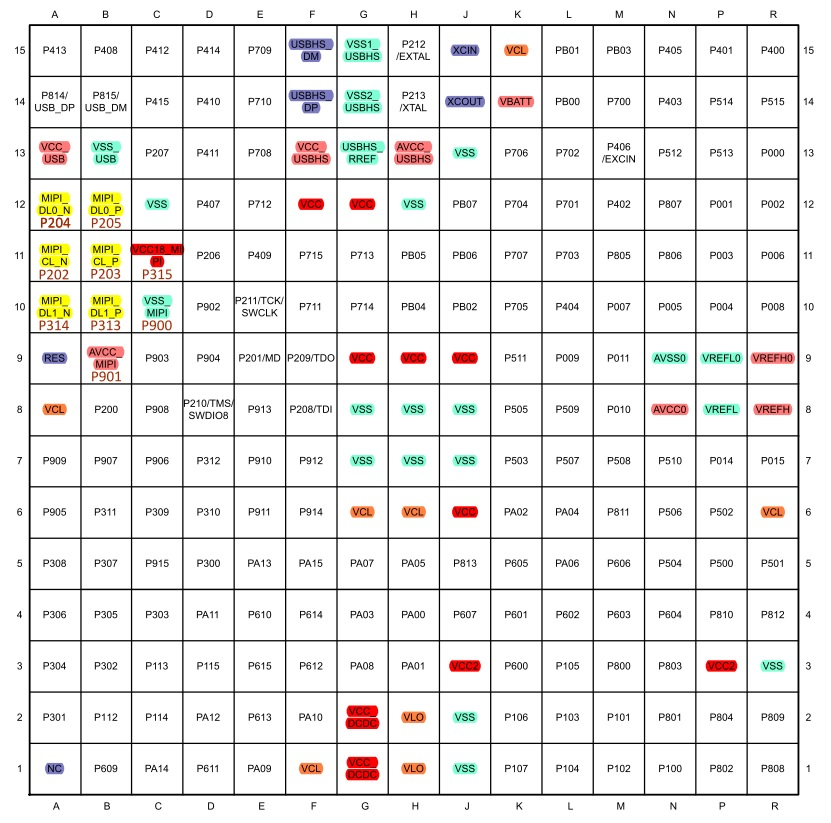

# gitstudy
Study functions of git

add 1st comment on Sept.18.

add 2nd comment on 20230804, hello, I am starting to use git for document control.

add 3rd comment on 20231009, re-start and trying.

test1 for local branch test
 

| aa   | bb                        | vv   |
| :--- | :------------------------ | :--- |
| 271  |  889 | 876  |
| 778  | 76    | 889  |
| duei |  **idue**   | uuei |
| 738  | dde                       |      |

[]

[连接到PDF](https://www.renesas.cn/cn/zh/document/dst/ra8m1-group-datasheet?r=25447396#page=2)

<A HREF="file:///ra8m1ds110.pdf">link</a>

<A HREF="file:///ra8d1.jpg">link</a>

| 核心板功能   | SDRAM | SPI Memory | 以太网    | 与核心板冲突的外设           | 扩展功能组2 | 扩展功能组3 |
| :----------- | :---- | :--------- | --------- | ---------------------- | ----------- | ----------- |
| CPKCOR-RA8D1 | 16位  | QSPI Flash | 无        | RGB565，RGB666，RGB888 |             |             |
| CPKCOR-RA8M1 | 16位  | QSPI Flash | Q         | 无                     |             |             |
| CPKCOR-RA8T1 | 16位  | QSPI Flash | QSPI NOR  |                        |             |             |
| CPKHMI-RA8D1 | 32位  | Octa Flash | 支持，POE |                        |             |             |
| CPKDIS-RA8D1 | 32位  | QSPI Flash | 不支持    |                        |             |             |
| MIPI接口     | BTB   | 不支持     | 不支持    |                        |             |             |

| 核心板功能           | AVCC_MIPI | VCC18_MIPI | AVCC0   | VCC      | VCC2     | SDRAM              | USB             |
| :------------------- | :-------- | :--------- | ------- | -------- | -------- | ------------------ | --------------- |
| 整板单电压           | =VCC      | 1.7~1.9    | =VCC    | 3.0-3.6  | =VCC     | =VCC               | =VCC            |
| HyperRAM/高速TF      | =VCC      | 1.7~1.9    | =VCC    | 3.0-3.6  | 1.65~3.6 | =VCC               | =VCC            |
| 低电压运行           | 3.0~3.6   | 1.7~1.9    | 2.7~3.6 | 1.65~3.0 | 1.65~3.6 | 3.0~3.6（不工作）  | =VCC （不工作） |
| 低电压运行（非MIPI） | N/A       | N/A        | 2.7~3.6 | 1.65~3.0 | 1.65~3.6 | 3.0~3.6 （不工作） | =VCC （不工作） |

测试VCC低于3V的运行条件时，SDRAM和USB不能使用。调试口需要加level shifter， SWDIO，SWCLK，RESET，TDI，TDO，UART3
SDRAM如果不拿下来，那要保证SDRAM有正确的供电，然后CS和RA8 MCU断开并上拉到正确的电平，。
以太网PHY(LAN8720)可以用低电压I/O,VCCA部分用3.3V

最经济的解决方案，VCC需要低电压时供电时，从底板直接供VCC给RA8。核心板上的VCC断开。

如果需要核心板单板调试，那就会比较复杂，需要3~4个电源，3.3给MIPI和AVCC，一个500mA的给VCC，一个1.8给MIPI，可能要单独的VCC2。
目前板上只有两个电源， 3.3和1.8，要实现这样的拓扑结构会十分复杂，还是放到底板上去考虑把。

整板用VCC 3.3V供电： VSYS <-> VCC,VCC <-> VCC2
VCC 3.3V供主要系统，VCC2低电压供Memory： VSYS <-> VCC, VCC_18 <-> VCC2

添加底板
VCC低电压供电,拆除SDRAM，VCC2低电压供Memory，VSYS供AVCCxxx：VSYS < X > VCC, VCC_18 <-> VCC2, 扩展板提供VCC供电（~1A）（如果有必要，VCC2也可以由底板供电）
