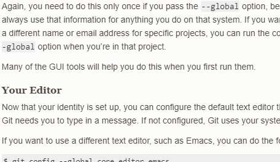

### CPKNET-RA8T2 32bit SDRAM sample code and speed test

Hardware: Either CPKNET-RA8T2 or CPKHMI-RA8P1, MP version

FSP: 6.1.0 

#### Sample program includes:

- 32bit SDRAM initialization
- Full memory READ/Write test: Patten 0x5A5A5A5A, 0xA5A5A5A5 repeat
- READ speed test (64K bytes)
    - CPU: Cached SDRAM -> D-TCM
    - CPU: Non-Cached SDRAM ->D-TCM
    - DMA: SDRAM-> D-TCM
- Write speed test (64K bytes)
    - CPU: D-TCM -> Non-Cached SDRAM
    - CPU: D-TCM -> Cached SDRAM (Write Through)
    - CPU: D-TCM -> Cached SDRAM (Write Back, with flush at the end)
    - DMA: D-TCM -> SDRAM

#### Deliverables：

- Sample project in ZIP format, includes:
  - Clean e2studio project (with debug and release configuration)
  - HEX binary compiled with “Release Configuration”
- Readme and operation manual in markdown format (same as CPK-RA8D1)

Note: BSP for CPK-RA8x2 will not be ready until SP 6.2.0, please set low voltage operation setting manually, consult Xu Jing or Ant for more details.

oioiwe

